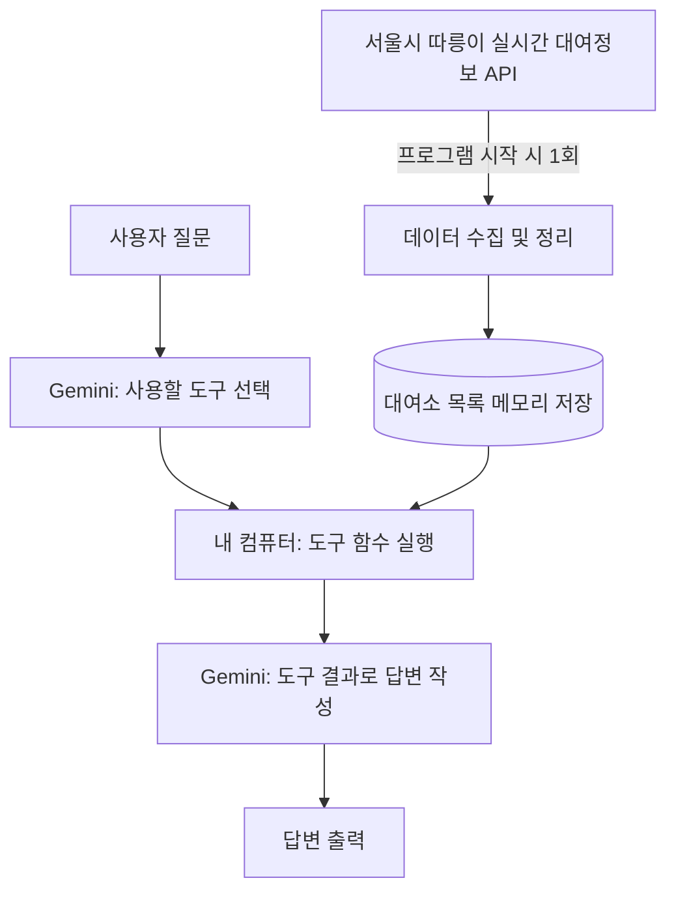

# 따릉이 실시간 대여소 안내 Agent

서울시 따릉이 실시간 대여정보를 도구로 사용해, 질문에 맞는 대여소와 대여 가능한 자전거 수를 알려주는 Python 기반 LLM Agent 프로토타입입니다.

> 예: "광운대 근처에 자전거 있는 대여소 알려줘" → 주변 대여소를 가까운 순으로 찾아 자전거 수와 거리를 안내

<br>

## 실행 화면

<!-- 실제 실행 화면 캡처로 교체하세요. images 폴더에 넣고 파일 이름을 맞추면 됩니다. -->


<br>

## 작동 방식



1. **데이터 수집**: 프로그램을 시작하면 서울 열린데이터광장 API에서 대여소 정보를 받아옵니다. API가 한 번에 최대 1,000건까지만 제공해, 1,000건씩 나누어 요청합니다.
2. **전처리**: 문자열로 들어오는 자전거 수, 거치대 수, 좌표를 숫자로 바꾸고, 형식이 깨진 행은 제외합니다.
3. **도구 선택**: 질문이 들어오면 Gemini가 질문을 해석해 어떤 도구를 어떤 값으로 부를지 정합니다. Gemini는 대여소 데이터 전체를 보지 않습니다.
4. **도구 실행**: 실제 검색과 거리 계산은 내 컴퓨터의 함수가 수행하고, 결과(최대 5곳)만 Gemini에 전달합니다.
5. **답변 작성**: Gemini가 도구 결과를 바탕으로 대여소 이름, 자전거 수, 거리를 담아 답합니다.

<br>

## 사용 데이터

| 항목 | 내용 |
|---|---|
| 출처 | 서울 열린데이터광장, 서울시 공공자전거 따릉이 실시간 대여정보 (`bikeList`) |
| 수집 규모 | 대여소 2,742곳 (전처리 제외 0건, 실행 시점 기준) |
| 사용 필드 | 대여소 이름, 자전거 주차 대수, 거치대 수, 위도, 경도 |

<br>

## Agent 도구

| 도구 | 하는 일 |
|---|---|
| `search_station(keyword)` | 대여소 이름에 키워드가 들어간 대여소의 실시간 자전거 수 조회 |
| `find_nearby(place, radius_m)` | 등록된 장소 좌표 기준 반경 안의 대여소를 하버사인 공식으로 계산해 가까운 순으로 조회 |

**응답 기준 (시스템 프롬프트)**
도구 결과에 있는 정보로만 답하고, 결과에 없는 내용은 추측하지 않고 확인할 수 없다고 답하도록 설정했습니다.

<br>

## 개발하며 겪은 문제와 해결

| 문제 | 해결 |
|---|---|
| 실행 중 Gemini 서버 혼잡(503 UNAVAILABLE)으로 답변이 중단됨 | 오류가 나도 프로그램이 종료되지 않도록 예외를 처리하고, 앞의 모델이 실패하면 다음 모델로 자동으로 넘어가도록 구조를 바꿈 |
| 거치대 수보다 자전거가 많은 대여소 발견 (예: 거치대 13개, 자전거 21대, 거치율 162%) | 데이터 오류가 아니라 거치대 밖에 세워 둔 자전거까지 집계된 것으로 판단. 빈 거치대 수를 계산할 경우 음수가 나오지 않도록 처리가 필요함을 확인 |

<br>

## 한계와 개선 계획

- **데이터 갱신**: 대여소 정보를 프로그램 시작 시 한 번만 받아, 오래 실행하면 실시간 정보와 차이가 생깁니다. 질문 시점에 다시 조회하거나 일정 주기로 갱신하는 방식으로 개선할 계획입니다.
- **장소 인식**: 미리 등록한 장소만 좌표를 알 수 있습니다. 주소를 좌표로 바꾸는 API를 도구로 추가하면 등록하지 않은 장소도 찾을 수 있습니다.
- **응답 평가**: 다양한 질문으로 정답률을 측정하고, 오답 원인을 분류해 프롬프트와 도구 설명을 개선할 예정입니다.

<br>

## 실행 방법

```bash
pip install google-genai requests
```

환경변수에 두 키를 설정합니다. 키는 코드에 직접 적지 않습니다.

```powershell
# Windows PowerShell
$env:SEOUL_API_KEY="서울 열린데이터광장 인증키"
$env:GEMINI_API_KEY="Google AI Studio API 키"
```

```bash
python bike_agent.py
```

<br>

## 기술 스택

Python · Google Gemini API (자동 함수 호출) · 서울 열린데이터광장 Open API · requests

개발 과정에서 AI 코딩 도구를 활용했으며, 데이터 수집부터 답변 생성까지의 흐름은 직접 실행하며 확인하고 수정했습니다.
